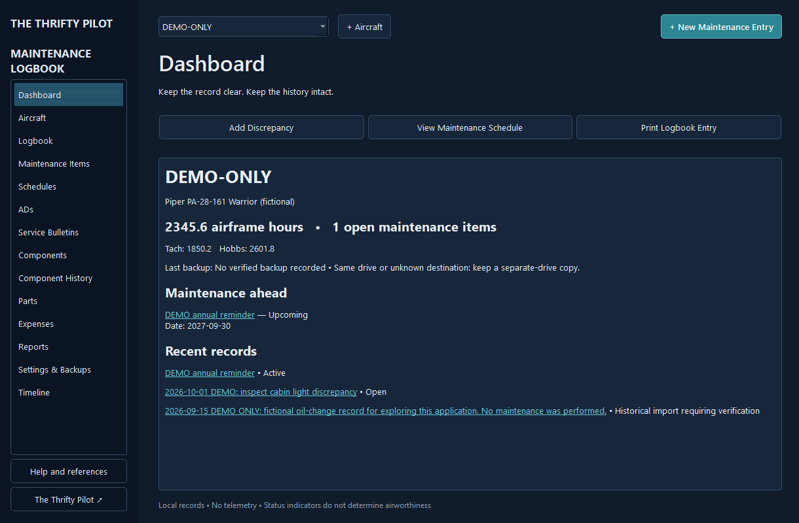

# The Thrifty Pilot | Aircraft Maintenance Logbook

A native, offline Windows desktop application for preparing, preserving and printing aircraft maintenance records. Python 3.13, PySide6 Qt Widgets, SQLite and ReportLab. Version 1.1.0-rc1 **stabilization evaluation candidate**; see the completion matrix and limitations before public distribution.



## Install or run
Use `dist/release/TheThriftyPilot-AircraftMaintenanceLogbook-Setup-1.1.0-rc1.exe`, or extract the portable ZIP and run `AircraftMaintenanceLogbook.exe` inside its folder. Keep the `_internal` directory beside the executable. End users do not need Python.

Download the installer, portable edition, source and SHA-256 checksums from the [1.1.0-rc1 prerelease](https://github.com/thethriftypilot/AircraftMaintenanceLogbook/releases/tag/v1.1.0-rc1).

The installer is unsigned. No signing certificate or Microsoft verification is claimed. This is an evaluation candidate, with independent aviation review and other acceptance checks still outstanding; see [known limitations](KNOWN_LIMITATIONS.md).

Developers:
```powershell
py -3.13 -m venv .venv
.\.venv\Scripts\python.exe -m pip install -r requirements-lock.txt
.\.venv\Scripts\python.exe -m logbook
.\.venv\Scripts\python.exe -m pytest -q
powershell -NoProfile -ExecutionPolicy Bypass -File scripts\build.ps1
```

Use `python -m logbook --demo` for isolated fictional sample data. The default real data folder is `%LOCALAPPDATA%\TheThriftyPilot\AircraftMaintenanceLogbook`. Optional `--data-dir` selects a development/test data folder.

## Working features
Multiple aircraft and identities; components and transfer events; draft autosave; distinct inspection validation; physical-signature blocks and managed signed scans; immutable finalized entries with append-only amendments; discrepancy tracking; manual AD/SB records; date/hour/cycle reminders; parts and expenses; searchable lists; multipage PDF and native print dialogs; historical CSV import with mapping; CSV/JSON exports; verified ZIP backups and confirmed restore.

No airworthiness verdict, FAA certification, certificate verification or compliant electronic-signature claim. Users are responsible for current regulations, work, authorization, signatures and accurate records. Full details: [User guide](USER_GUIDE.md), [regulatory limitations](REGULATORY_LIMITATIONS.md), [known limitations](KNOWN_LIMITATIONS.md).

## Evidence and engineering
- [Build instructions](BUILD_WINDOWS.md) and [installation](INSTALLATION.md)
- [Architecture](ARCHITECTURE.md) and [database schema](DATABASE_SCHEMA.md)
- [Test results](TEST_RESULTS.md), [test plan](TEST_PLAN.md), [completion matrix](COMPLETION_MATRIX.md)
- [Regulatory reference matrix](REGULATORY_REFERENCES.md)
- [Security/privacy](SECURITY_AND_PRIVACY.md), [release notes](RELEASE_NOTES.md)
- MIT license for original code; dependencies retain their own terms in [third-party inventory](THIRD_PARTY_LICENSES.md)

The common three-minute workflow and full production release criteria require user acceptance and independent aviation review. Do not mistake successful automated tests for that review.
